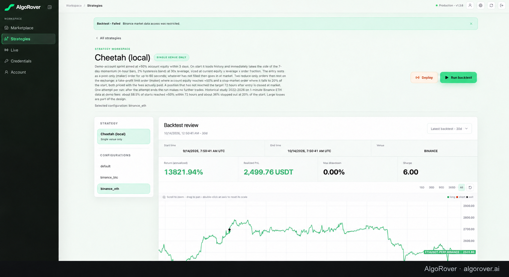
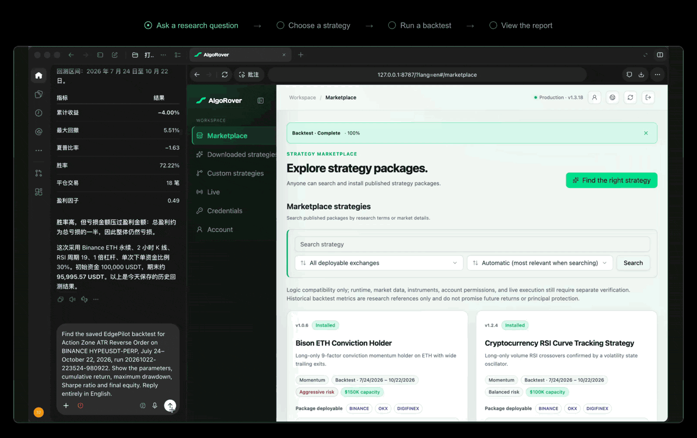
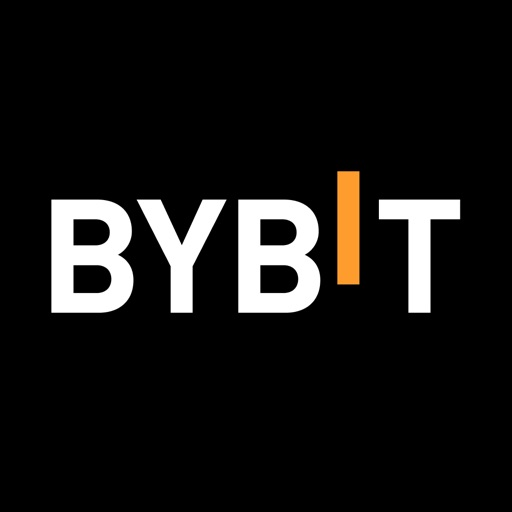
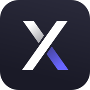

<picture>
  <source media="(prefers-color-scheme: dark)" srcset="./readme-assets/algorover-logo-white.svg">
  
</picture>

# AlgoRover

AlgoRover, formerly EdgePilot. This is the same project under a new brand, with its development history and community preserved.

A free AI tool for quantitative strategy research, reproducible backtesting, and local execution in Codex or Claude Code. Explore 4,000+ strategies, customize them through AI conversations, and test your own trading ideas.

Use **AlgoRover Research** for strategy discovery and historical backtesting. Use **AlgoRover Live** for exchange demo trading and automated live execution.

[Website](https://algorover.ai) · [Research Guide](https://algorover.ai/en/research/) · [Live Guide](https://algorover.ai/en/live/) · [Strategies](https://algorover.ai/en/strategies/) · [Evidence](https://algorover.ai/en/evidence/) · [Security](https://algorover.ai/en/security/) · [Blog](https://blog.algorover.ai/)

[Choose your edition](#choose-your-edition) · [Quick start](#quick-start) · [Workflow](#see-the-workflow) · [Compatibility](#requirements-and-compatibility) · [Security](#security-and-control) · [FAQ](#frequently-asked-questions) · [Support](#documentation-and-support)

[X / Twitter](https://x.com/AlgoRoverQuant) · [Discord](https://discord.gg/DvsA8gQ3Y) · [Telegram](https://t.me/+TGpYk0NlbD4zYTVk)



Describe a research question, inspect the strategy evidence, and review results in your local Dashboard.

## What is AlgoRover?

AlgoRover connects natural language requests in your AI workspace to local research and execution tools. Its library contains 4,000+ strategies, including strategies uploaded and shared by experienced traders. Browse the library, inspect a strategy, and install it with one click.

Through AI conversations, you can change trading rules, parameters, markets, and risk limits. You can also bring in strategies from other sources and validate your own version with reproducible historical backtests.

Research uses public market data to discover, configure, compare, and backtest strategies. Research data and reports remain local. Live adds exchange demo and automated live trading through an API connection to your own exchange account. Starting live execution requires your confirmation of the strategy and risk settings.

Existing installations may still show **EdgePilot** or **EdgePilot Research** and use legacy `edgepilot` identifiers. Existing users do not need to reinstall or rename their configuration because of the rebrand. For new installations, use the current AlgoRover commands below.

## Choose your edition

| Capability | AlgoRover Research | AlgoRover Live |
| :--- | :---: | :---: |
| Strategy discovery and configuration | ✓ | ✓ |
| Historical backtesting | ✓ | ✓ |
| Research results and reports | ✓ | ✓ |
| Exchange demo trading | — | ✓ |
| Live trading | — | ✓ |
| Trading credentials | Not required or accepted | Configured locally when required |

Start with Research to explore and backtest without connecting a trading account. Choose Live if you also need exchange demo or live execution.

[Explore Research](https://algorover.ai/en/research/) · [Explore Live](https://algorover.ai/en/live/)

## What can you do?

### Discover strategies to investigate

Browse 4,000+ strategies. Filter by asset, source, and timeframe; inspect rules and historical evidence; compare candidates; and install a strategy with one click.

```text
Find three strategies to research for BTC on the 1-hour timeframe. Explain their rules, data requirements, key risks, and what evidence is available. Do not place trades.
```

### Customize a strategy or bring your own

Use AI conversations to adjust rules, parameters, markets, and risk settings. Add strategies from other sources and backtest your customized version before execution.

```text
Create my own local version of this strategy. Adapt it to BTC on the 1-hour timeframe, explain the rule and parameter changes, and backtest it with explicit fees and slippage. Do not place trades.
```

### Evaluate a backtest beyond its return

Inspect the test period, data, costs, drawdown, and robustness before drawing conclusions.

```text
Review this backtest. State the data source, test period, parameters, fees, slippage, maximum drawdown, and limitations. Identify what I should verify before trusting the result.
```

### Prepare for demo trading with Live

Check compatibility and operating limits before starting an execution workflow.

```text
Use AlgoRover Live to check whether this strategy supports Demo mode on the selected exchange. List the required configuration, position limits, and stop conditions. Do not start execution yet.
```

## Quick start

Choose your AI workspace, then install Research or Live. If you install both editions, add the marketplace only once.

### Codex

Research:

```bash
codex plugin marketplace add AlgoRover/algorover-hub --ref main
codex plugin add algorover-research@algorover
```

Live:

```bash
codex plugin marketplace add AlgoRover/algorover-hub --ref main
codex plugin add algorover@algorover
```

### Claude Code

Research:

```bash
claude plugin marketplace add AlgoRover/algorover-hub@main
claude plugin install algorover-research@algorover
```

Live:

```bash
claude plugin marketplace add AlgoRover/algorover-hub@main
claude plugin install algorover@algorover
```

### Cursor

Use the Cursor-specific plugin copies:

| Edition | Plugin directory |
| :--- | :--- |
| Research | `plugins/cursor/edgepilot-research` |
| Live | `plugins/cursor/AlgoRover` |

Copy the selected directory into Cursor's local plugin directory, then reload the window:

| Platform | Local plugin directory |
| :--- | :--- |
| macOS and Linux | `~/.cursor/plugins/local/` |
| Windows | `%USERPROFILE%\.cursor\plugins\local\` |

The Codex and Claude plugin copies use different host bindings. For Teams or Enterprise, import the repository through **Dashboard → Plugins and MCPs**.

### Start your first session

Reload plugins or start a new session after installation. For Research, paste this into your AI chat:

```text
Set up AlgoRover Research, open the Dashboard, and start the interactive strategy onboarding.
```

For Live:

```text
Set up AlgoRover Live, open the Dashboard, and start the interactive strategy onboarding. Do not start trading.
```

Follow the setup prompts. Plugin installation and Runtime startup are separate steps.

## See the workflow



| Step | What you do | What to inspect |
| :--- | :--- | :--- |
| Discover | Describe a market question | Strategy rules and evidence |
| Configure | Set market, timeframe, and parameters | Data availability and assumptions |
| Backtest | Request a historical test | Costs, drawdown, and robustness |
| Review | Inspect the report | Reproducibility and limitations |
| Execute with Live | Configure a supported mode | Permissions, limits, and stop conditions |

Historical and simulated results are not guarantees of future performance.

## How it works

| Component | Role |
| :--- | :--- |
| AI workspace | Describe tasks and review responses |
| AlgoRover plugin | Connect supported requests to the local Runtime |
| Local Runtime | Perform research, backtesting, and supported execution tasks |
| Dashboard | Setup, results, and operating controls |

This repository is the marketplace for plugin distribution. Runtime downloads are delivered through each product's public channel.

## Requirements and compatibility

- Node.js must be available to the host.
- The AI workspace must permit the required plugins and local processes.
- Runtime compatibility depends on the product, operating system, and release channel.
- Live login and credential setup take place in the Dashboard.

Check the [Research Guide](https://algorover.ai/en/research/) or [Live Guide](https://algorover.ai/en/live/) before installation.

### Exchange compatibility

#### AlgoRover Live

Account data and execution integrations for 14 exchanges and brokers:

| Exchange / broker | Account reading | Execution integration |
| :--- | :---: | :---: |
|  Alpaca | ✓ | ✓ |
| <picture><source media="(prefers-color-scheme: dark)" srcset="./readme-assets/exchanges/architect-ax-white.svg"></picture> Architect AX | ✓ | ✓ |
|  Binance | ✓ | ✓ |
|  Bitget | ✓ | ✓ |
|  BitMEX | ✓ | ✓ |
|  Bybit | ✓ | ✓ |
|  Deribit | ✓ | ✓ |
|  DigiFinex | ✓ | ✓ |
|  dYdX | ✓ | ✓ |
|  Gate.io | ✓ | ✓ |
|  Hyperliquid | ✓ | ✓ |
|  Kraken | ✓ | ✓ |
|  Longbridge | ✓ | ✓ |
|  OKX | ✓ | ✓ |

Available trading modes depend on the installed adapters and account environment. Longbridge requires a Runtime with Longbridge support.

#### AlgoRover Research

Public historical candlesticks for backtesting, without trading credentials:

| Data source | Historical backtest data |
| :--- | :--- |
|  Binance | USD-M and COIN-M futures |
|  OKX | Historical candlesticks |
|  DigiFinex | Perpetual futures |

## Security and control

- Research does not connect trading accounts, accept trading credentials, or place orders.
- Live API keys and trading credentials remain local.
- Starting live execution requires your confirmation of the strategy and risk settings.
- Funds remain in your exchange account; AlgoRover does not custody user funds.

Read the [Security Overview](https://algorover.ai/en/security/), [Privacy Policy](https://algorover.ai/privacy/), and [Terms of Service](https://algorover.ai/terms/).

## Frequently asked questions

### Which edition should I install first?

Choose Research for strategy discovery and historical backtesting. Choose Live when you also need demo or live execution workflows.

### Does installing the plugin start trading?

No. Installation does not start trading. Runtime setup and execution are separate actions.

### Do I need exchange API keys for Research?

No. Research does not require or accept trading credentials.

### Can I install both editions?

Yes. They serve different workflows. Enable only one marketplace source for each product to avoid conflicting copies.

### The plugin is installed. Why is the Runtime unavailable?

Reload the plugin or start a new session, then request AlgoRover setup. Confirm that your host supports local processes and that your platform is supported.

### What does `runtime_identity_incompatible` mean?

Update the plugin and reload its session. Runtime repair cannot change the plugin's Runtime bindings.

## Documentation and support

| Resource | Use it for |
| :--- | :--- |
| [Research Guide](https://algorover.ai/en/research/) | Installation and research workflows |
| [Live Guide](https://algorover.ai/en/live/) | Demo and live execution workflows |
| [Strategy Library](https://algorover.ai/en/strategies/) | Discover, compare, and install strategies |
| [Evidence](https://algorover.ai/en/evidence/) | Reproducible research and stress testing |
| [Security](https://algorover.ai/en/security/) | Credentials, data, and control boundaries |
| [Blog](https://blog.algorover.ai/) | Research methods and worked examples |
| [GitHub Issues](https://github.com/algorover/algorover-hub/issues) | Installation and plugin bugs |

When reporting an issue, include the plugin version, host, operating system, steps to reproduce, and a redacted error message. Never include credentials, tokens, or private account information.

## Distribution and release provenance

The marketplace is generated from production plugin ZIPs through the source repository's `./build.sh marketplace-sync` command. Published releases include a `release.json` that records input and generated plugin hashes. Credentials, the Runtime, and user state are not stored in this repository.

README images are kept in `readme-assets/`. Plugin artwork stays in each generated plugin's own `assets/` directory.

New installation marketplace ID: `algorover`.
